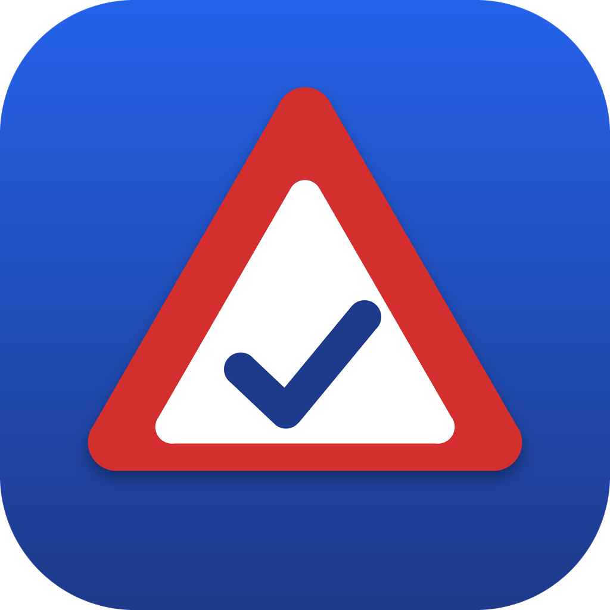

<p align="center">
  
</p>

<h1 align="center">Führerschein Quiz Südtirol</h1>

<p align="center">
  Alle <b>7.020 offiziellen Prüfungsfragen</b> für den Führerschein <b>A/B</b> – auf <b>Deutsch und Italienisch</b>.<br>
  Für <b>Android</b> und <b>Windows</b>, kostenlos, ohne Werbung, mit automatischen Updates.
</p>

<p align="center">
  <a href="https://github.com/laufish44/fuehrerschein-quiz-suedtirol/releases/latest"><b>⬇️ Neueste Version herunterladen</b></a>
</p>

---

## Installation

**Android:** Lade die Datei `FuehrerscheinQuiz-…-android.apk` aus dem [neuesten Release](https://github.com/laufish44/fuehrerschein-quiz-suedtirol/releases/latest) herunter und öffne sie. Beim ersten Mal fragt Android, ob du Apps aus dieser Quelle installieren darfst – einmal erlauben, fertig.

**Windows:** Lade `FuehrerscheinQuiz-…-windows-setup.exe` herunter und starte sie. Weil das Programm nicht von einer Firma signiert ist, zeigt Windows eventuell „Der Computer wurde durch Windows geschützt“ → *Weitere Informationen* → *Trotzdem ausführen*.

**Updates:** Beide Apps prüfen beim Start, ob es auf GitHub eine neue Version gibt, laden sie herunter und installieren sie. Unter Windows passiert das komplett im Hintergrund, unter Android tippst du einmal auf „Installieren“ (Android erlaubt außerhalb des Play Stores keine ganz stille Installation).

## Funktionen

**Lernen**
- Kapitel wie im Südtiroler Theoriebuch (24 Kapitel), mit Fortschritt je Kapitel
- **Schwierige Fragen:** deine persönlich schwierigen Fragen plus typische Fallen (fast gleich klingende Aussagen mit gegenteiliger Lösung)
- Modi: der Reihe nach, zufällig, nur neue, nur ungelernte, nur Fehler
- **Lernen nach Bild:** alle Aussagen zu einem Verkehrszeichen zusammen üben
- **Intelligent lernen:** Spaced Repetition – falsch beantwortete Fragen kommen öfter, gelernte seltener
- **Meine Fehler:** jede falsche Frage bleibt drin, bis du sie mehrmals in Folge richtig hast
- Auflösung sofort oder erst am Ende der Runde (umschaltbar)

**Prüfung**
- **Offizielle Simulation:** 30 Fragen aus allen Kapiteln, 20 Minuten, bestanden mit max. 3 Fehlern – Oberfläche wie bei der echten Prüfung (Nummernleiste 1–30, Antworten änderbar bis zur Abgabe)
- **Eigenes Quiz:** Anzahl, Zeit, erlaubte Fehler, Kapitel und Fragenauswahl frei wählbar
- Verlauf aller Prüfungen mit Fehleranalyse

**Statistik**
- Prüfungsreife: geschätzte Chance, die Prüfung jetzt zu bestehen
- Lernstand aller Fragen (gelernt / am Lernen / Fehler / neu)
- Wissen je Kapitel, schwächste Kapitel
- Verlauf: Fragen pro Tag, Trefferquote, Lernzeit (7/14/30/90 Tage)
- Prüfungsverlauf, Tagesserie, Tagesziel, schwierigste Fragen

**Extras**
- Deutsch ⇄ Italienisch umschaltbar, optional beide Sprachen gleichzeitig
- Vorlesen (Text-to-Speech)
- Favoriten, eigene Notizen, Volltextsuche über alle Fragen
- Verkehrszeichen-Lexikon mit allen richtigen und falschen Aussagen pro Bild
- Tägliche Lern-Erinnerung und Countdown bis zum Prüfungstermin
- Hell-/Dunkelmodus, Tastatursteuerung unter Windows (R / F / Enter / ←)

**KI-Erklärungen – ohne eingebauten API-Schlüssel**
- Offline-Erklärungen zu allen 7.020 Aussagen direkt in der App (auf Deutsch; in der italienischen Ansicht vorerst ebenfalls auf Deutsch)
- „KI fragen“: öffnet ChatGPT, Claude oder Perplexity mit der Frage und der offiziellen Lösung schon eingefügt
- Optional: eigenen kostenlosen Gemini-Schlüssel eintragen und direkt in der App chatten (inkl. Bild der Frage) – meist in 1–2 Sekunden; hängt Gemini, fragt die App automatisch parallel ein zweites Modell

**Sync & Backup**
- Anmeldung mit dem eigenen Google-Konto: Der Lernstand liegt in einem versteckten App-Ordner im eigenen Google Drive – Handy und PC bleiben auf demselben Stand. Die App sieht nur ihre eigene Datei, und die Anmeldung bleibt auf dem eigenen Gerät ([Datenschutz](https://laufish44.github.io/fuehrerschein-quiz-suedtirol/privacy.html))
- Export/Import als Datei; beim Import wird nichts überschrieben, sondern zusammengeführt

## Hinweise

- Die Fragen stammen aus der offiziellen Liste des Ministeriums für Infrastruktur und Verkehr (deutsche und italienische Fassung, „Conseguimento A-B“). Maßgeblich ist immer die offizielle Lösung.
- Die Erklärungen wurden mit KI erstellt und können Fehler enthalten.
- Dies ist kein offizielles Angebot des Ministeriums oder der Autonomen Provinz Bozen.

## Entwicklung

Flutter-App (Android, Windows, Web). Die Fragen werden mit `tools/extract_questions.py` aus den beiden PDFs erzeugt:

```bash
python tools/extract_questions.py "Conseguimento A-B tedesco.pdf" "Conseguimento A-B italiano.pdf" assets
```

Neue Version veröffentlichen: Version in `CHANGELOG.md` eintragen, dann

```bash
git tag v1.3.0 && git push origin v1.3.0
```

GitHub Actions baut daraufhin APK und Windows-Installer und erstellt das Release ([release.yml](.github/workflows/release.yml)).

Die Google-Anmeldung braucht einen OAuth-Client vom Typ „Desktop-App“ mit dem Bereich `drive.appdata`. Client-ID und Secret stehen nicht im Code, sondern als Repository-Secrets `GOOGLE_CLIENT_ID` und `GOOGLE_CLIENT_SECRET` und werden beim Bauen mit `--dart-define` gesetzt. Lokale Builds ohne diese Werte laufen ohne Anmeldung.

Lizenz des Codes: MIT.
